  

    

  <!-- Monochromatic Quick Actions -->
  
  
  
  

 

### ⚡ Proof of Work

| 04 | Active Users | Spring Boot 3 | Full-Stack |
| :---: | :---: | :---: | :---: |
| **Production Apps** | **Client-Commissioned** | **Enterprise Backend** | **React & TypeScript** |

---

### 👨‍💻 Engineering Profile

3rd-year Software Engineering undergraduate at **SLIIT** (Sri Lanka Institute of Information Technology), focused on architecting resilient enterprise backend services and modern data-intensive web applications.

Experienced across the full development lifecycle—from relational schema design and complex SQL migrations to secure **RESTful/JWT API design** and reactive **React/TypeScript** frontends. Proven track record taking client-commissioned solutions from initial system requirements to production deployments with active users.

---

### 🛠️ Technical Arsenal

<table>
  <tr>
    <td width="160"><b>Languages</b></td>
    <td>
      
      
      
      
      
      
    </td>
  </tr>
  <tr>
    <td><b>Backend &amp; APIs</b></td>
    <td>
      
      
      
      
      
      
    </td>
  </tr>
  <tr>
    <td><b>Frontend</b></td>
    <td>
      
      
      
      
      
    </td>
  </tr>
  <tr>
    <td><b>Database &amp; Cloud</b></td>
    <td>
      
      
      
      
    </td>
  </tr>
  <tr>
    <td><b>Tooling &amp; Practice</b></td>
    <td>
      
      
      
      
      
    </td>
  </tr>
</table>

---

### 🏛️ Featured Engineering Systems

| System | Architecture | Engineering Highlights | Source |
| :--- | :--- | :--- | :---: |
| **[FORT](https://github.com/lithafawfadh/FORT)** | React · TypeScript · Supabase · PostgreSQL · Tailwind | Real-time financial ledger & group fund management system built for 9 active users. Engineered with cascading SQL migrations, role-based row-level security (RLS), and live state sync. | [Code ↗](https://github.com/lithafawfadh/FORT) |
| **[Skill Connect](https://github.com/lithafawfadh/Skill-Connect)** | Spring Boot 3 · React 18 · Spring Security · MySQL | Full-stack skilled labor & equipment booking platform. Features 4 distinct role-based management dashboards, JWT stateless authentication, threaded messaging, and automatic late-fee engines. | [Code ↗](https://github.com/lithafawfadh/Skill-Connect) |
| **[Health Plus](https://github.com/lithafawfadh/Health-Plus)** | React · Azure · Appwrite · Tailwind | Cloud-enabled pharmacy management system deployed to Azure. Implements serverless backend functions, digital prescription tracking, and cashier/pharmacist access isolation. | [Code ↗](https://github.com/lithafawfadh/Health-Plus) |
| **[Sales Receipt Engine](https://github.com/lithafawfadh/Sales-Receipt-Generator)** | React · TypeScript · Tailwind CSS · Supabase | Mobile-first production receipt generator featuring high-throughput client bulk entries, dynamic tax/discount computation engine, and automatic PDF export. | [Code ↗](https://github.com/lithafawfadh/Sales-Receipt-Generator) |

---

  Open to Software Engineering Internships (Dec 2026 / 2027) · On-site, Hybrid & Remote Worldwide

<!-- Verified SWE Portfolio by Mohamed Lithaf Awfadh -->
